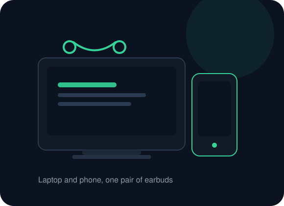
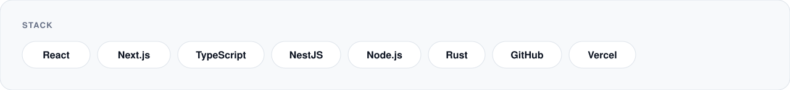

<a href="https://rehankamboh.vercel.app/">
  <picture>
    <source media="(prefers-color-scheme: dark)" srcset="assets/header-dark.svg">
    
  </picture>
</a>

  
  
  
  

Hi, I'm Muhammad Rehan Kamboh. I build websites, frontend and backend. BudMix is my Windows app: a laptop and a phone, in one pair of Bluetooth earbuds. I use React, Next.js, NestJS, and Rust.

### Featured: BudMix

<table>
<tr>
<td>
<b>A laptop and a phone, in one pair of Bluetooth earbuds.</b> The earbuds stay on the laptop. Phone sound comes in by Wi-Fi Cast or Bluetooth, and Windows mixes both. Nothing is installed on the phone. There is no account, and the shortcut is Ctrl+Alt+B.
  

&nbsp;

  
Rust · Windows
</td>
<td width="290"></td>
</tr>
</table>

### About

<table>
<tr>
<td align="center" width="56"></td>
<td width="220"><b>Websites</b> Layout · Type · Motion</td>
<td>I build the pages, the type, and the motion. A site starts as a layout, then becomes a working page where the spacing and motion match.</td>
<td align="right"></td>
</tr>
<tr>
<td align="center" width="56"></td>
<td width="220"><b>Frontend</b> React · Next.js · TypeScript</td>
<td>I build the pages people use with React and Next.js: the layout, the type, and how a site responds when someone clicks, scrolls, or resizes it.</td>
<td></td>
</tr>
<tr>
<td align="center" width="56"></td>
<td width="220"><b>Backend</b> NestJS · Node.js</td>
<td>I write the server side with NestJS and Node.js, so a site can store data and answer requests.</td>
<td></td>
</tr>
<tr>
<td align="center" width="56"></td>
<td width="220"><a href="https://github.com/Mrehankamboh/BudMix"><b>BudMix</b></a> Rust · Windows</td>
<td>A Windows app. The earbuds stay on the laptop. Phone sound comes in by Wi-Fi Cast or Bluetooth, and Windows mixes both.</td>
<td align="right"></td>
</tr>
<tr>
<td align="center" width="56"></td>
<td width="220"><b>Stack</b> TypeScript · Rust</td>
<td>React, Next.js, and TypeScript for the pages. NestJS and Node.js for the server. Rust for BudMix.</td>
<td></td>
</tr>
<tr>
<td align="center" width="56"></td>
<td width="220"><b>Shipping</b> GitHub · Vercel</td>
<td>The code stays on GitHub under Mrehankamboh. When a site is ready, it goes live on Vercel.</td>
<td align="right"></td>
</tr>
</table>

### Stack

<picture>
  <source media="(prefers-color-scheme: dark)" srcset="assets/stack-dark.svg">
  
</picture>

<a href="https://rehankamboh.vercel.app/">Portfolio</a>
· <a href="mailto:work.rehankamboh@gmail.com">work.rehankamboh@gmail.com</a>
· <a href="https://wa.me/923280865468">+92 328 0865468</a>
· <a href="https://www.linkedin.com/in/muhammad-rehan-223225436/">LinkedIn</a>
· <a href="https://github.com/Mrehankamboh">GitHub</a>

